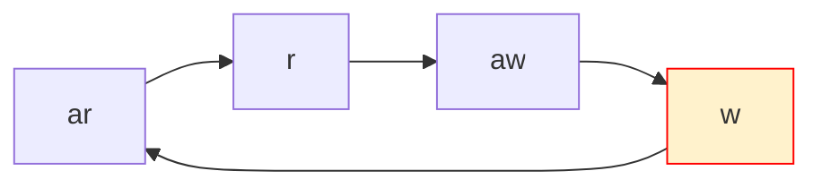

#### 结论

msc的连接，引入了约束：如果awvalid没有及时来，wready会被拉低。

#### AXI各通道的时序关系





dma写sram时，需接收sram的wready信号，指示sram已经准备好接收写入的数据

sram输出的wready为长高，但经过msc时被拉低，进而导致下一组数据的ar信号无法发出。

攒够达到burst长度的数据量，arvalid重新置位，现象为arvalid被延后。rvalid随之延后。

awvalid在rvalid之后，同样需要攒够达到burst长度的数据量后才能置位，现象为awvalid被延后。wvalid随之延后。

最终形成由于wready被扰动造成的负反馈。

#### 为什么只有core下的sram数据互相搬运出现了此问题

core下的sram数据互相搬运场景下，sram输出的wready始终为高，受msc影响最大。其他慢速场景下wready本身就有较多拉低情况，因此几乎没有影响。

上图为core下的sram数据互相搬运场景


#### MSC拉低wready的机制与代码

msc内部计数：msc_w_cntr受inc/dec_w_cntr影响进行加减

inc_w_cntr即为awvalid

dec_w_cntr为有效的wlast

awvalid没有及时来，msc_w_cntr会减为0，导致wready拉低

```systemverilog
	wready_s = (w_cntr > cntr_t'(0)) ? wready_m : 1'b0;

assign inc_w_cntr = (inc_aw_cntr & ~aw_pass_reg) | aw_pass_set;
assign dec_w_cntr = wvalid_s & wready_s & wlast_s;

always_comb begin
  w_cntr_next = w_cntr;
  if (inc_w_cntr && ~dec_w_cntr && ~w_cntr_maxed) begin
    w_cntr_next = cntr_t'(w_cntr + cntr_t'(1));
  end
  else if (dec_w_cntr && ~inc_w_cntr) begin
    w_cntr_next = cntr_t'(w_cntr - cntr_t'(1));
  end
end
```

