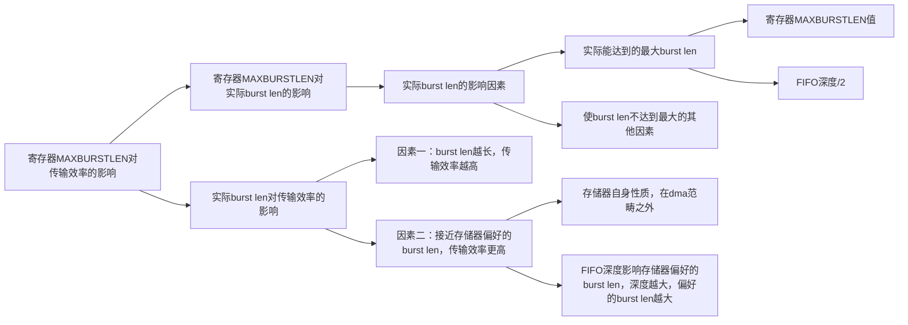
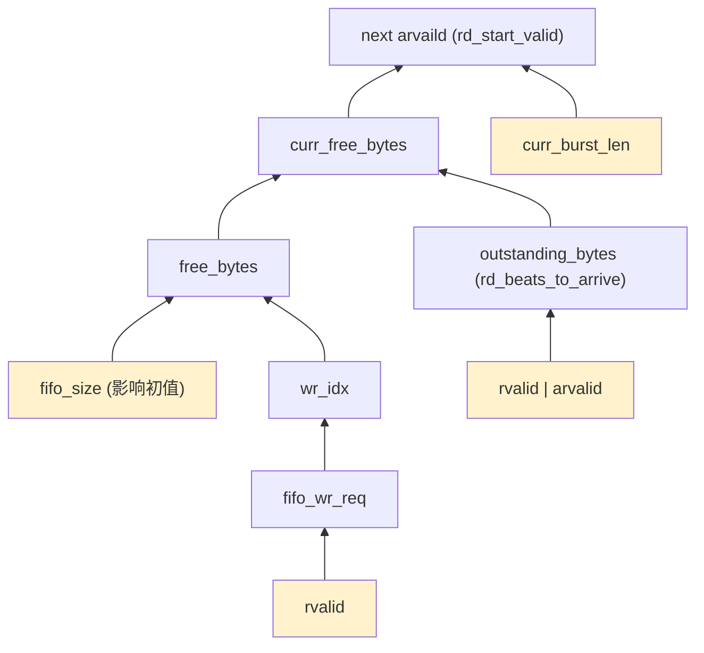

### 结论

- 不考虑存储器情况，burst len越大传输效率越大
- 存储器对burst len偏好不同，偏离多，传输效率降低
- 排除fifo深度对burst len影响之外，也会影响传输效率



### 效率图示

<div style="width:820px;max-width:60%;margin:20px auto;"><svg viewBox="0 0 820 430" xmlns="http://www.w3.org/2000/svg" style="width:100%;height:auto;font-family:Arial,sans-serif;"><g stroke="#dddddd" stroke-width="1"><line x1="90" y1="304" x2="750" y2="304"/><line x1="90" y1="244" x2="750" y2="244"/><line x1="90" y1="184" x2="750" y2="184"/><line x1="90" y1="124" x2="750" y2="124"/><line x1="90" y1="64" x2="750" y2="64"/></g><g stroke="#555" stroke-width="1.5"><line x1="90" y1="50" x2="90" y2="340"/><line x1="90" y1="340" x2="750" y2="340"/></g><g font-size="13" fill="#555" text-anchor="middle"><text x="100" y="365">1</text><text x="190" y="365">2</text><text x="280" y="365">3</text><text x="370" y="365">4</text><text x="460" y="365">5</text><text x="550" y="365">6</text><text x="640" y="365">7</text><text x="730" y="365">8</text></g><g font-size="13" fill="#555" text-anchor="end"><text x="78" y="309">150</text><text x="78" y="249">200</text><text x="78" y="189">250</text><text x="78" y="129">300</text><text x="78" y="69">350</text></g><text x="420" y="405" font-size="15" text-anchor="middle" fill="#333">Real Burst Length</text><text x="24" y="195" font-size="15" text-anchor="middle" fill="#333" transform="rotate(-90 24 195)">Speed (MB/s)</text><polyline points="100,288.77 190,322.45" fill="none" stroke="#4C78A8" stroke-width="3" stroke-linejoin="round" stroke-linecap="round"/><polyline points="100,160.04 190,76.45 280,76.10 370,78.18 460,108.93 550,156.46 640,239.59 730,262.72" fill="none" stroke="#E45756" stroke-width="3" stroke-linejoin="round" stroke-linecap="round"/><g stroke="#4C78A8" stroke-width="1.5"><line x1="100" y1="288.46" x2="100" y2="289.61"/><line x1="95" y1="288.46" x2="105" y2="288.46"/><line x1="95" y1="289.61" x2="105" y2="289.61"/><line x1="190" y1="321.76" x2="190" y2="323.98"/><line x1="185" y1="321.76" x2="195" y2="321.76"/><line x1="185" y1="323.98" x2="195" y2="323.98"/></g><g stroke="#E45756" stroke-width="1.5"><line x1="100" y1="159.41" x2="100" y2="160.82"/><line x1="95" y1="159.41" x2="105" y2="159.41"/><line x1="95" y1="160.82" x2="105" y2="160.82"/><line x1="190" y1="74.54" x2="190" y2="80.42"/><line x1="185" y1="74.54" x2="195" y2="74.54"/><line x1="185" y1="80.42" x2="195" y2="80.42"/><line x1="280" y1="74.63" x2="280" y2="77.62"/><line x1="275" y1="74.63" x2="285" y2="74.63"/><line x1="275" y1="77.62" x2="285" y2="77.62"/><line x1="370" y1="77.48" x2="370" y2="78.56"/><line x1="365" y1="77.48" x2="375" y2="77.48"/><line x1="365" y1="78.56" x2="375" y2="78.56"/><line x1="460" y1="108.80" x2="460" y2="109.04"/><line x1="455" y1="108.80" x2="465" y2="108.80"/><line x1="455" y1="109.04" x2="465" y2="109.04"/><line x1="550" y1="155.68" x2="550" y2="157.60"/><line x1="545" y1="155.68" x2="555" y2="155.68"/><line x1="545" y1="157.60" x2="555" y2="157.60"/><line x1="640" y1="239.33" x2="640" y2="240.22"/><line x1="635" y1="239.33" x2="645" y2="239.33"/><line x1="635" y1="240.22" x2="645" y2="240.22"/><line x1="730" y1="262.24" x2="730" y2="263.40"/><line x1="725" y1="262.24" x2="735" y2="262.24"/><line x1="725" y1="263.40" x2="735" y2="263.40"/></g><g font-size="14"><line x1="570" y1="28" x2="605" y2="28" stroke="#4C78A8" stroke-width="3"/><text x="613" y="33" fill="#333">ch0~3</text><line x1="665" y1="28" x2="700" y2="28" stroke="#E45756" stroke-width="3"/><text x="708" y="33" fill="#333">ch4~8</text></g></svg></div>

### 相关代码

```verilog
assign rd_start_valid = (fifo_level_t'(curr_burst_len) <= curr_free_bytes) &&
                        (current_burst_len_beats != '0) &&
                        rd_start_en
                        ? rd_state_fsm[1] & (inc_valid | ~inc_enabled)
                        : 1'b0;

assign curr_free_bytes = fifo_level_t'(free_bytes - outstanding_bytes);

assign free_bytes = empty ? fifo_level_t'(FIFO_SIZE_BYTES): (1'b0, idx_t'(rd_idx -wr_idx)}
                                                          
assign fifo_rd_req = axi.sig.wvalid & axi.sig.wready & ~wr_fill;

assign fifo_wr_req = axi.sig.rvalid & ~axi_stopping & ~read_err_set & ~read_pois_set;

assign outstanding_rd_beats = rd_beats_to_arrive;
                                                             
always_ff @(posedge clk or negedge resetn) begin
    if (~resetn) begin
        rd_beats_to_arrive <= '0;
    end
    else if (axi.sig.rvalid && axi.sig.rready || axi.sig.arvalid && axi.sig.arready) begin
        rd_beats_to_arrive <= rd_beats_to_arrive_nxt;
    end
end
```

###  代码分析




